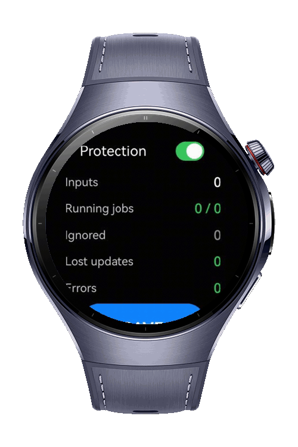
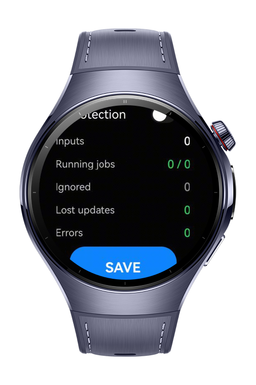
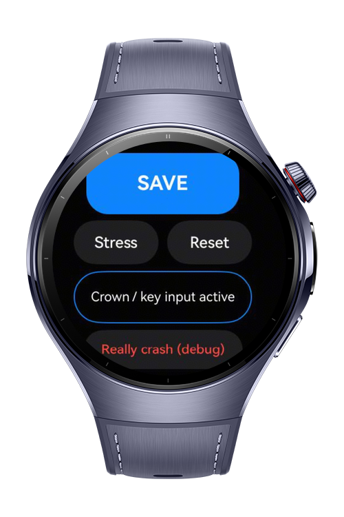

> **Note:** To access all shared projects, get information about environment setup, and view other guides, please visit [Explore-In-HMOS Index](https://github.com/Explore-In-HMOS/hmos-index).

# How to Handle Rapid Input and Prevent App Crashes on Wearables

This HarmonyOS wearable sample shows how to process rapid input safely. Rapid input includes taps, digital crown rotation, and key presses. If rapid input starts the same async job many times, the jobs run at the same time. This can cause lost updates, null-reference errors, and an app restart.

The sample has one page with a **Protection** switch. When the switch is off, the page shows the problem. When the switch is on, a debouncer, a throttle, and a re-entrancy guard process the input. Then, only one save job runs at a time. Counters and an event log show the result of each input.

# Preview

<div>
  
  
  
</div>

# Use Cases

- Reproduce a rapid-input crash on a watch with one stress test (30 inputs in 1 second)
- Debounce digital crown events to process only the last rotation
- Throttle repeated taps and reject parallel async jobs with a re-entrancy guard
- Disable a button while its job runs
- Prevent late async results from changing a closed page
- Record uncaught errors with `errorManager` and show them on the next start

# Technology

## Stack

- **Languages**: ArkTS, ArkUI
- **Frameworks**: HarmonyOS Stage Model
- **Tools**: DevEco Studio, Hvigor
- **Libraries**:
	- `@kit.ArkUI`
	- `@kit.AbilityKit` (`UIAbility`, `errorManager`)
	- `@kit.ArkData` (`preferences`)
	- `@kit.PerformanceAnalysisKit` (`hilog`)

## Required Permissions

- None

## Counters

| Counter | Description |
|---|---|
| Inputs | The number of taps, crown events, key presses, and stress inputs that the app received. |
| Running jobs `a / b` | `a` is the number of save jobs that run now. `b` is the highest number of jobs that ran at the same time. `b` must not be more than 1. |
| Ignored | The number of inputs that the throttle, the debouncer, or the re-entrancy guard rejected. |
| Lost updates | The number of increments that a parallel job wrote over. |
| Errors | The number of errors that the app caught. Without protection, each of these errors causes a crash and a restart in a real app. |

## Reproduce the Problem

1. Set the **Protection** switch to off.
2. Tap **Stress**.
   - As an alternative, tap **SAVE** quickly.
   - As an alternative, tap the crown area and turn the crown quickly.
3. Examine the counters:
   - **Running jobs** increases to more than 1.
   - **Lost updates** increases. Parallel jobs read the same value and write over the result of each other.
   - **Errors** increases. The log shows `TypeError` entries. A job uses the shared `activeSession` field after a different job cleared it.
4. For a debug build only, tap **Really crash (debug)**.
   - The app throws an uncaught error.
   - `CrashObserver` records the error.
   - When you start the app again, an orange banner shows "The previous session crashed".

> **NOTE:** The sample catches the `TypeError` to count it. A real app does not catch this error, and the app crashes.

The unsafe code is in `SaveService.save()`. This method reads a value, waits, and writes the value back. It also uses a shared session field. The sample keeps this unsafe code to show the effect of the fix.

## Fix the Problem

1. Set the **Protection** switch to on.
2. Tap **Stress**.
3. Make sure that:
   - **Running jobs** stays at 1.
   - **Errors** stays at 0.
   - **Lost updates** stays at 0.
   - **Ignored** increases.

| Layer | Location | Function |
|---|---|---|
| Throttle (leading, 500 ms) | `common/Throttler.ets` | Rejects a tap, key press, or stress input that comes less than 500 ms after the last accepted input. |
| Debounce (trailing, 300 ms) | `common/Debouncer.ets` | Changes a stream of crown events into one input. Only the last event in a 300 ms window starts a save. |
| Re-entrancy guard | `common/ReentrancyGuard.ets` | Lets only one save job run at a time. The guard sets its lock immediately. Thus, it also rejects a second call in the same frame. |
| UI lock | `Button.enabled(...)` | Disables **SAVE** while a save job runs. |
| `isAlive` flag | `pages/Index.ets` | Prevents async jobs that end after the page closes from changing `@State`. |
| Timer cleanup | `aboutToDisappear`, `SaveService.dispose()` | Cancels all pending `setTimeout` and `setInterval` timers when the page closes. |
| Crash observer | `service/CrashObserver.ets` | Records uncaught errors. Shows the error on the next start. |

> **NOTE:** In a production app, also correct `SaveService.save()`. Use a local session reference. Update the counter in one atomic operation. This sample keeps these defects to show the effect of input protection alone.

# Directory Structure

```
entry/
|   src/
|       main/
│   module.json5
│
├───ets
│   ├───common
│   │       Constants.ets
│   │       Debouncer.ets
│   │       Logger.ets
│   │       ReentrancyGuard.ets
│   │       Throttler.ets
│   │
│   ├───entryability
│   │       EntryAbility.ets
│   │
│   ├───model
│   │       TapStats.ets
│   │
│   ├───pages
│   │       Index.ets
│   │
│   └───service
│           CrashObserver.ets
│           SaveService.ets

```

# Constraints and Restrictions

## Supported Device

- Huawei Watch 5
- HarmonyOS smart wearables
- Round-screen wearable layouts are the primary target

## Notes

- The digital crown API (`onDigitalCrown`) requires API 18 or later.
- The page receives crown events only when the crown area has the focus. Tap the crown area before you turn the crown.

# License

**How to Handle Rapid Input and Prevent App Crashes on Wearables** is distributed under the terms of the MIT License. See the [LICENSE](LICENSE) for more information.
